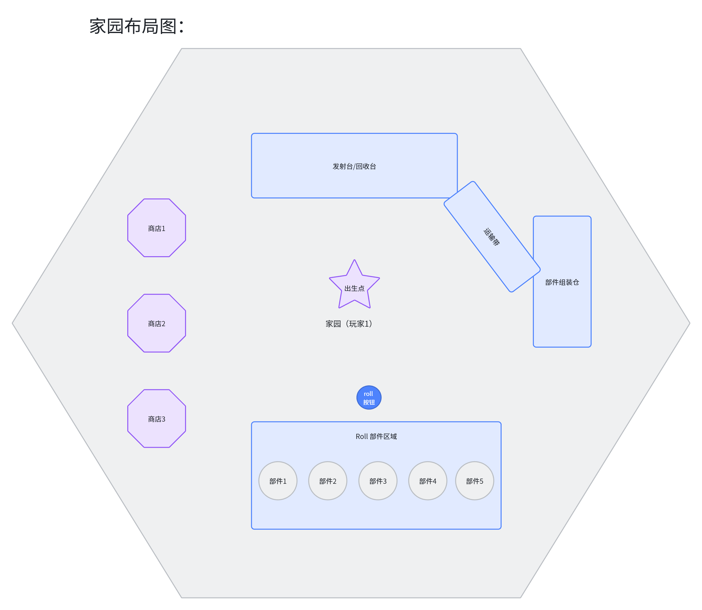
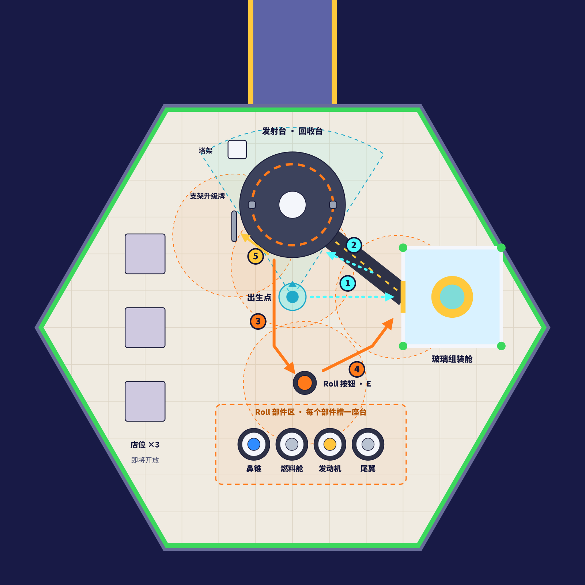

# Roblox 火箭发射游戏 · 设计方案

**2026 年 11 月 19 日讨论整理，11 月 23 日更新（含家园布局调整）｜分两阶段：Demo 验证 → 正式制作**

六名玩家在同一个世界里，各自在家园 Roll 部件、在玻璃组装舱里拼火箭、亲手点火。玩家通过 Roll 获得更好的部件，部件的**组合**决定火箭的性能（Δv）和能飞到哪里；最优组合才能飞到第二颗星球木星。玩家也可以升级回收支架，提高每次回收的收益。**单轮目标约 1～2 分钟。首航结束后就交回控制权，观察玩家前五分钟能否独立飞完第二趟，并主动准备第三趟。**

## 开发阶段规划

方案分为两个阶段。**阶段一 · Demo 验证**用 Web Demo 验证核心循环和"爆点"手感，回答"好不好玩、爽不爽"；**阶段二 · 正式制作**在 Roblox 中实现完整游戏，加入社交、变现和长线内容。

| | 阶段一 · Demo 验证 | 阶段二 · 正式制作 |
|---|---|---|
| 目标 | 验证核心循环、组合玩法和高光时刻的手感 | 在 Roblox 上线完整游戏，做大社交传播和长线留存 |
| 平台 | Web Demo（Three.js），NPC 邻居占位 | Roblox Studio，真实六人同服 |
| 已完成 | 首航引导、Roll 与抽件演出、玻璃组装舱、四槽部件与 Δv、点火 / 过门 / 星尘碎片 / 完美接住、木星解锁演出、全局特效、镜头规则、Roblox 标准 UI、Web 打包；**四个阶段一爆点功能已实现（11 月 23 日）** | — |
| 新增爆点功能 | **超级发射**（M）、**轨道狂热**（S–M）、**连续完美接住**（S）、**华丽坠毁**（M） | **引擎试车**（S）、**头奖彗星**（M）、**弹弓收尾**（M）、**烟花十连抽**（M）、**锻造融合**（M–L）、**全服时刻**（发射编队、木星风暴、星球插旗） |
| 其他工作 | 试玩、数值调整、记录验证问题 | 服务器权威逻辑、数据保存、真实多人、变现、更多星球、上线运营 |

规模：S 为小型，M 为中型，L 为大型，按现有 Demo 的复用程度估算。两个阶段的新增功能详见「阶段一 · Demo 验证新增功能」和「阶段二 · 正式制作功能」。

**爆点设计原则**：玩家可控的蓄力 → 突然释放 → 逐级放大的回报 → 其他玩家看得见。最大的场面（超级发射、精英烟花、木星风暴）保持稀有，不在每个事件上叠满特效，否则什么都不再突出。

## 更新记录

| 日期 | 主要变化 |
|---|---|
| 11 月 19 日 | 初版：核心循环、首航引导、六人世界布局、两套绕行奖励候选、多星球航线待验证规则。 |
| 11 月 22–23 日 | 2D Web Demo → 3D Web Demo。新增玻璃组装舱、四槽部件与 Δv 性能模型、"组合决定能否到木星"、点火/过门/接住三处技巧操作、星尘碎片玩法、木星解锁演出、全局特效、镜头规则、Roblox 标准 UI，并打包为可上线的 Web 版本。 |
| 11 月 23 日 | 方案拆分为「Demo 验证」和「正式制作」两个阶段，并把爆点功能分配到两个阶段。 |
| 11 月 23 日 | 3D Demo 实现阶段一四个爆点功能：超级发射、轨道狂热、连续完美接住、华丽坠毁；新增 3 名围观访客 NPC 和对应的飞行提示。 |
| 11 月 23 日 | **家园布局调整**：出生点移到家园中央，出生后面向发射台；原 Roll 机改为家园下方的 Roll 部件区，火箭有几个部件槽就有几座部件台（目前 4 座），并在部件区前方加一个 Roll 按钮，按 E 后所有部件台同时 Roll。组装舱移到右侧中部，运输带斜向接到发射台。 |
| 11 月 23 日 | Roll 定价与保底：每次 Roll 50 金币（一次出 4 件）；每座部件台独立计数，连续 10 次没出精英即进入保底，每次 Roll 从保底中的台里随机挑 1～2 座必出精英。支架升级牌移到回收支架旁，发射塔架移到发射台左后方。**Web Demo 已同步新布局和新 Roll 规则。** |
| 11 月 23 日 | **背包与待组装**：部件先进入背包，同一种部件叠成一格，重复只增加数量（×N），取消原「重复 +1★、绕行金币 +5%」的星级加成。玩家在组装舱里从背包选件放进四个槽位（待组装），待组装期间可替换、移出部件，点「组装」才开始组装。台上已有的火箭不受待组装影响，组装出新火箭后才替换。 |
| 11 月 23 日 | **Roll 免费、部件按价购买**：按 Roll 按钮不花钱，开出的部件摆在部件台上标价出售，玩家用金币买下想要的部件，买下后进入背包。价格按部件种类和档次定义；基础件不限量、不出售。取代上一条「每次 Roll 50 金币」。**Web Demo 已同步背包、待组装、免费 Roll 和部件购买（存档版本升级，旧进度会重置）。** |
| 11 月 24 日 | **组装舱定稿（C2 机械科技版）**：部件坞、龙门吊、焊接机械臂、三色状态灯，组装演出改为约 5.6 秒的机械流程。**部件台定稿（C1）**：去掉展示笼，部件悬浮在台面上方；价格、名称、稀有度改为悬在部件上方的 GUI 卡（BillboardGui）。**Roll 按钮取消冷却**，只在约 1.2 秒的开箱动画期间暂不响应。Web Demo 已同步去掉冷却和新的 GUI 标签，组装演出仍是旧版。 |
| 11 月 23 日 | 降低 PERFECT 难度：修正火箭视觉与判定点错位（原先鼻锥比判定点早约 0.3 s 穿门），过门窗口放宽约 50%，光圈收缩到门框实际大小，新增三声节拍提示和输入延迟补偿，绕月改用追随镜头。 |

## 核心玩法参考 · Steel Fighters

按本次讨论的游玩观察，《Steel Fighters》的玩家 Roll 机器人部件，选件组装，让机器人上场战斗，再用战斗收益升级机器人相关属性。玩家刚换好的部件很快就能上场，战斗表现让玩家看见这次组装的效果。[Roblox 游戏页](https://www.roblox.com/games/74122653145285/Steel-Fighters)

火箭 Demo 里，对应战斗的环节是点火后的实际飞行。比如玩家 Roll 到大燃料舱并装上，预览从一圈变为两圈。首航绕完一圈就返航，这枚火箭经过同一个轨道标记后继续飞，第二次经过时再跳出一笔绕行奖励。玩家沿用相同的部件、只升级支架时，变化则出现在着陆结算的回收奖金上。

### 第一版 Demo 的问题与对策

第一版 Demo 跑通了循环，但缺少刺激感和满足感。原因和对应改法如下，均已在 3D Demo 中实现。

| 问题 | 原因 | 对策 |
|---|---|---|
| 飞行没有悬念 | 预览说两圈，实飞就是两圈，只是确认 | **预览给保底，操作给上限**：预览显示的圈数和航线保证兑现，点火、过门、接住的时机操作在保底之上加成 |
| 飞行时无事可做 | 点火后 1～2 分钟只能看 | 每圈过门点 BOOST、圈中点星尘碎片、返航时接住火箭 |
| 收益平、线性 | 每圈 10 金币，升级只是 +10 | 连圈加成、各类倍率相乘并逐项显示；木星每圈 60 |
| 升级只改一个数字 | 换件只改变圈数 | 四个部件槽各有质量和性能，组合决定 Δv 和航线，外形同步变化 |
| 收益到账没有仪式感 | 结束时一次性到账 | 每圈金币弹出、逐行计数的结算单、金币飞入计数器 |

## 一趟火箭怎么玩

**免费 Roll，在部件台上买下想要的部件（进入背包）→ 在玻璃组装舱从背包选件放进槽位（待组装），查看性能 → 点「组装」，观看部件组装、火箭沿传送带送上发射台 → 按住点火、在绿区松手 → 沿本趟航线绕星，过门点 BOOST、点击星尘碎片 → 返航，在绿区接住火箭 → 结算领取金币 → Roll 部件或升级支架，再次发射。**

### 首航 · 新手引导（已实现）

1. **走到组装舱按 E。** 基础件已经放在四个槽位里（待组装），按「组装」，观看部件落位、焊接、火箭出舱送上发射台。
2. **走到发射台按 E 点火。** 按住按钮，指针在绿区时松手。
3. **首航过门。** 收缩的光圈套住金色轨道门时点 BOOST。
4. **接住火箭。** 火箭底部进入绿色接住区时点 CATCH。结算到账后引导结束。

引导期间，下一个目标上方有跳动的金色箭头，顶部有步骤横幅。引导结束后的两步仍有提示：第一次 Roll 时燃料舱部件台必出大燃料舱，并且这一件免费赠送（直接进入背包），然后提示「大燃料舱已放进背包，回组装舱把它放进燃料舱槽，看 Δv 上涨」，再发射一次即完成。

### 第二趟起 · 自主游玩

玩家自己发起 Roll、买下部件、从背包选件、组装和发射。普通部件仍能组出可飞的火箭，Roll 有概率出现高一级部件。选件时，组装舱实时显示 Δv、推重比、航线和预计收益，每个候选部件都标出它会让 Δv 增减多少，随后可在实飞和回收结算中核对。

| 环节 | 玩家做什么、能看到什么 |
|---|---|
| 抽件与组装 | 免费 Roll，在部件台上用金币买下想要的部件，部件进入背包。在组装舱从背包为鼻锥、燃料舱、发动机、尾翼四个槽选件（待组装），可随时替换或移出。舱内全息投影实时显示整枚火箭的外形，面板显示 Δv 条（带月球和木星刻度）、推重比、质量、稳定度、金币倍率和航线。确认后按「组装」，在玻璃舱里看部件依次落位。 |
| 上台与发射 | 组装完成的火箭自动经传送带送上发射台。玩家走到台边按 E，按住点火、在绿区松手，获得点火加成。 |
| 绕星与回收 | 每圈经过轨道门时点 BOOST 判定；圈中点击星尘碎片可增强下一道门。返航时火箭底部进入绿色接住区时点 CATCH，支架合拢接住。 |
| 下一趟 | 继续 Roll 部件、换出更好的组合，或升级回收支架。 |

## 场景布局 · 六人世界与玩家家园

### 世界布局

世界场景布局参考《Mine a Planet》。从实机俯视图可以看到，中央是一块连续的公共平台，数条短桥向外连接各玩家的平台。相邻平台之间露出星空，从广场看过去，桥通向谁家、各家设施摆在哪里都容易辨认。

**火箭 Demo 的布局。** 六块六边形家园靠近中央活动广场，每家通过一段短而宽的平面通道与广场连成一片。按图中比例，通道的净宽略大于从家园边缘走到广场边缘的距离，靠广场一端稍微放宽。灰盒试走时，两名玩家应能并排通过，也能迎面错身。发射台朝内，入口位于发射台侧边，访客经过时能看到火箭上台、点火和着陆。相邻家园之间留出开敞的星空，让玩家从组装机旁抬头时能看见邻居的火箭升空。公共商店沿广场边缘预留，避开六个入口，中央留给主题活动和观看发射。每位玩家独享自己的部件、组装机、发射台、回收支架和收益。

**3D Demo 的实现。** 家园为外接半径 42 studs 的六边形平台，广场 46 studs，两者中心相距 110 studs，桥宽 14 studs（两侧黄色护栏）。平台顶面带 Roblox 经典凸点纹理，底部为悬浮岩体。自家边缘为绿色，其他五家各有一种代表色。广场中央是放大的火箭雕塑，六根灯柱。其余五家由 NPC 占位：每隔 25～50 秒自行发射一次、绕月返航，回收后在玩家列表里加金币，用来验证共享天空和同场观看的感受。

**Roblox 场景的实现（11 月 24 日确认）。** 为满足「通道净宽略大于通道长度」，家园与广场的中心距由 110 缩短为 **94 studs**：桥长约 17.8、总宽 22（护栏内净宽约 20.2），广场端护栏外撇放宽；相邻家园平边相对，中间留约 21 studs 开敞星空。广场以世界原点为中心，玩家自家位于 (0, 0, 94)，家园本地 −Z 朝广场，上表「家园设施坐标」直接适用。天空用紫色星云天空盒；由于 Roblox 夜间会隐藏自定义天空盒，光照改用白天时段（ClockTime 14.5）并隐藏太阳，以淡紫环境光营造夜空感。Neon 只用于地台边下方的家园色细线、灯具、光柱、轨道线与轨道门、星球光晕和护盾，护栏、岩体晶体不发光。（Web Demo 仍为 110，待同步。）**11 月 25 日起尺寸改为下一段的放大版。**

**场景放大约 1.3 倍（11 月 25 日确认）。** 用户参考《Mine a Planet》认为场景偏小，整体放大约 1.3 倍，**设施模型本身尺寸不变**（A3 比例尺、火箭高度都不变），只拉开设施间距：
- **地台**：家园外接半径 42 → **55**（平边到平边约 95），广场 46 → **60**（约 104），中心距 94 → **122**。桥长约 22.4、总宽 26（护栏内净宽约 24.2），仍满足净宽大于桥长；相邻家园间留约 27 studs 星空。玩家自家位于 (0, 0, 122)。
- **装饰**：悬浮岩体的深度、碎石、晶体跟着 ×1.3；广场中央圆台 Ø18 → Ø24；广场光柱高 50 → 65，家园色光柱高 120 → 156，位置 (18, apo − 6) → (23.4, apo − 6)。
- **星球**：以广场中心为基准整体 ×1.3（位置、半径、轨道、轨道门一起缩放）：月球 (−65, 247, −78)、r 36.4、轨道半径 67.6；木星 (221, 520, −286)、r 93.6。
- **步行时间**（WalkSpeed 16）：家园到广场中心约 6 秒 → 7.6 秒。
- 下表「家园设施坐标」已换成放大后的数值。Web Demo 仍是旧尺寸，待同步。

**邻居家园、广场商店与飞行比例（11 月 24 日确认）。** 其余五家用**简化版（LOD）**：与自家同一套布局和坐标，保留发射台、L1 支架、塔架、玻璃组装舱外形、转台、龙门吊、运输带、4 座部件台（待机态）、Roll 按钮和店位外形，去掉警示条纹、管线、部件坞、机械臂、文字牌和点光源，每家约 160–210 件（自家全量 586 件）。各家台上火箭组合不同，从自家能看出邻居的进度。**广场公共商店 3 个**，放在桥与桥之间的 30° / 150° / 270° 三个空档（30° 空档紧邻自家桥），另外三个空档留给后续内容。Roblox 版飞行中的火箭**放大 1.5 倍**（Web Demo 为 1.9，待同步）；判定仍以火箭中心为准。

### 单人家园布局

家园图上方朝向广场（11 月 23 日调整）。发射与回收共用上方同一座台，玩家出生在家园中央、**出生后面向发射台**。玻璃组装舱在右侧中部，一条运输带从组装舱斜向接到发射台右端。**Roll 部件区在家园下方**：火箭由几种部件组成，部件区就有几座部件台（目前鼻锥、燃料舱、发动机、尾翼共 4 座，以后增加部件槽时同步加台）。部件区前方有一个 **Roll 按钮**，按 E 交互后所有部件台同时 Roll。三个家园店位沿左侧预留，具体用途随商店系统确定。

- **首航。** 玩家出生在家园中央，一睁眼正对发射台，右手边就是组装舱。用基础件组装后，火箭经运输带送上台，玩家向前走到台边亲手点火。
- **第二趟起。** 火箭落回原台，金币到账。玩家可以在左侧回收支架旁的升级牌升级支架，也可以转身向下走到 Roll 按钮，一次 Roll 出全部部件，再到右侧组装舱换件、再次发射。出生点位于三处设施的中间，到发射台、组装舱和 Roll 按钮的距离相近。

**美术布局图（B1）。** 按上面的布局图和下方坐标绘制，上方为中央广场。青色虚线是首航动线（① 出生点 → 组装舱，② 组装舱 → 发射台），橙色实线是循环动线（③ 回收后 → Roll 按钮，④ Roll → 组装舱），黄色是可选的 ⑤ 支架升级；橙色虚线圆为 10 studs 交互范围，青色扇形为出生点的初始视野。

**家园设施坐标**（以家园中心为原点，广场方向为 −Z，单位 studs；按 11 月 23 日布局图换算。11 月 25 日场景放大后，各设施组按约 1.3 倍外移、组内相对位置不变；括号里是放大前的值。Web Demo 仍是放大前的值，待同步）：

| 设施 | 位置 | 说明 |
|---|---|---|
| 发射台 / 回收台 | (0, −26)〔(0, −20)〕 | 朝向广场；两侧为回收支架，发射塔架在左后方 (−9, −35)〔(−9, −29)〕 |
| 玻璃组装舱 | (33.8, −6.5)〔(26, −5)〕 | 右侧中部，出口门朝向发射台 |
| 运输带 | (26.2, −6.5) → (6.58, −21.1)〔(18.4, −5) → (6.2, −14.6)〕 | 从组装舱门斜向接到发射台右侧边缘，火箭组装后自动送上台 |
| 出生点 | (0, −6.5)〔(0, −5)〕 | 家园中央，出生朝向 −Z（面向发射台） |
| Roll 按钮 | (2.6, 11.7)〔(2, 9)〕 | 按 E 交互；位于出生点与 Roll 部件区之间；概率牌在 (7, 11.7) |
| Roll 部件区 | 中心 (3.9, 24.7)，约 37 × 13〔(3, 19)，31 × 13〕 | 每个部件槽一座部件台，沿 X 方向间距 8 排开（原 6.2，台与台贴边）；4 座台位于 x = 15.9 / 7.9 / −0.1 / −8.1（鼻锥、燃料舱、发动机、尾翼）。11 月 24 日改为反向排列：玩家从出生点转身面朝 +Z 走向 Roll 区时，从左到右读到 鼻锥 → 尾翼 |
| 支架升级牌 | (−9.5, −22.5)〔(−9.5, −16.5)〕 | 紧挨左侧回收支架，面向出生点 |
| 三个店位 | (−31.2, −15.6 / 0 / 15.6)〔(−24, −12 / 0 / 12)〕 | 显示「即将开放」 |

### 公共天空与灰盒验证

六人共享同一颗月球，首轮先将月球放在广场上空试摆。玩家站在组装机靠家园外侧的一边操作，抬头就能看向发射台和天空。高机柜、店招放在视线两侧。旁观者应能认出谁的火箭、飞向哪里、已绕几圈。可用同一家园色标记台灯和尾焰，在火箭旁显示玩家名和圈数。

世界布局图和单人家园图用于确定设施的相对位置。先搭两块相邻家园，在手机上观察玩家首次回收后能否自行找到 Roll 区，以及站在组装机旁抬头能否跟到邻居的火箭绕月。根据这两次体验调整家园间距、广场大小、发射台和月球高度。再铺满六家，验证同时发射时仍能跟踪自家火箭落回原台。加入第二颗星球时，从各家视角检查能否看清跨星转向。

## 玻璃组装舱

组装机改为**机械科技风格的玻璃组装舱**（原画 C2，11 月 24 日确认）：外框 16 × 16、底座 18 × 18、总高约 22 studs。**只有舱门对面的一面是石墨色机械墙**（部件坞、管线），其余三面都是**整面玻璃观察窗**（11 月 24 日调整，原为两面机械墙），前角不设立柱，从舱外各个方向都能看清组装过程。「待组装」信息屏挂在舱门上方的门楣上、朝向舱外。舱内有顶部**龙门吊**（横梁 + 小车 + 缆绳抓爪）、两台落地式**焊接机械臂**、中央**转台升降台**（两侧液压支柱），舱门朝发射台、向两侧滑开，舱外有面向玩家的**控制台**。

### 背包与待组装（11 月 23 日）

部件的流向是 **免费 Roll → 在部件台购买 → 背包 → 组装舱槽位（待组装）→ 组装 → 发射台**。

| 环节 | 规则 |
|---|---|
| 进入背包 | 在部件台买下的部件自动进入背包（见「Roll 抽件」）。买下时提示「已放入背包」；如果它能让当前待组装的组合更好，再提示「回组装舱可提升 +N 金币 / 趟」 |
| 背包叠放 | 按部件槽分四页（鼻锥、燃料舱、发动机、尾翼）。**同一种部件叠成一格，重复只增加数量（×N）**，没有其他加成。每格显示稀有度、数量，以及放进当前组合后 Δv 和每趟金币的增减。走到组装舱按 E 时背包自动打开，HUD 左上也有背包按钮可随时查看 |
| 数量 | 放进槽位的部件从背包取出 1 个（数量 −1），移出或被替换时退回背包（+1）。数量为 0 的格子变灰但保留，显示「已全部放入」。基础件不限数量，保证任何时候都能组出可飞的火箭 |
| 放入槽位 | 在背包里点一个部件，它就放进组装舱对应的槽位；槽里已有部件时直接替换，旧部件回到背包。放入时部件出现在左侧机械墙对应的部件坞上（托架亮起，轻响一声） |
| 待组装 | 四个槽位都可以在组装前随意修改：替换、点槽位上的 ✕ 移出（回到背包）。待组装的内容会保存，离开组装舱再回来仍在。面板实时显示这套组合的 Δv、推重比、航线和预计收益 |
| 组装 | 四个槽位都放满、且组合能飞时，「组装」按钮才可用；缺件时按钮显示「还缺：鼻锥」，飞不起来时显示原因（例如「太重，推重比 0.92」）。点「组装」后锁定槽位，播放组装演出 |
| 台上的火箭 | 待组装不会影响已经在发射台上的火箭，玩家仍可直接发射它。新火箭组装完成后替换台上的旧火箭，旧火箭上的部件退回背包。台上火箭和待组装组合不同时，发射台提示显示「组装舱里有新组合，可先组装」，但不阻止发射 |

**舱内的待组装表现。** 放进槽位的部件摆在舱门对面机械墙的 **4 个部件坞**上（鼻锥、燃料舱、发动机、尾翼各一个托架），空的部件坞托架闪青色虚线，玩家站在舱外就能看出还缺哪一件。中央转台上显示这套组合的青色全息轮廓并缓慢旋转。替换部件时，旧部件从部件坞淡出、新部件落入。四件放齐且组合能飞时，舱顶状态灯由青色转为绿色，舱外控制台和「组装」按钮开始呼吸发光。

- **全息预览。** 打开组装舱后，转台上显示待组装组合的青色全息轮廓并缓慢旋转，实体部件摆在部件坞上。换件时模型随之变化，并伴有小火花和金属声。镜头切到组装舱机位，面板在桌面端停靠右侧、手机端停靠底部，画面自动让出空间。
- **组装演出（约 5.6 秒，全部由舱内机械完成）。**
  1. 0.2 s 起：龙门吊移到发动机坞，抓爪夹起发动机，吊到转台中央放下，撞击产生火花和金属声。
  2. 1.3 s 起：两台机械臂从尾翼坞取出尾翼，依次装到发动机四周，各自在根部迸出火花。
  3. 2.4 s 起：龙门吊吊起燃料舱，下降对接到发动机上方，机械臂沿接缝焊一圈。
  4. 3.6 s 起：龙门吊吊起鼻锥落位。
  5. 4.3–5.2 s：两台机械臂沿所有接缝随机点焊，转台带着火箭缓慢转一圈。
  6. 5.6 s：「火箭组装完成」并显示 Δv 和航线；舱门向两侧滑开，火箭经传送带送上发射台。
  （Web Demo 仍是旧的 4.8 秒「从舱顶落下」演出，待同步。）
- **反馈细节。** 火花受重力下落并在地面弹跳；每次撞击伴随橙色闪光（点光源）、轻微镜头抖动，部件越重，火花越多、声音越响。舱顶状态灯：青色 = 待组装（有空槽或组合飞不起来），绿色 = 可组装 / 组装完成，黄橙闪烁 = 组装中。
- **缺件或无法飞行的组合不能组装。** 缺件时按钮显示「还缺：××」；飞不起来时显示「这套组合飞不起来」，并给出原因。

## 部件与性能

四个部件槽，每槽三档（Basic / Advanced / Elite），共 81 种组合。每个部件都有质量；部件之间互相取舍，没有一套组合样样最好。

| 部件槽 | 基础 | 高级 | 精英 | 作用 |
|---|---|---|---|---|
| 鼻锥 | 基础鼻锥 1.0 t · 阻力 1.0 · 金币 ×1 | 气动鼻锥 0.6 t · 阻力 0.7 · 金币 ×1.3 | 黄金鼻锥 1.8 t · 阻力 0.9 · 金币 ×2.2 | 阻力损失、金币倍率 |
| 燃料舱 | 基础燃料舱 1.0 t · 燃料 3 t | 大燃料舱 1.6 t · 燃料 6 t | 巨型燃料舱 2.6 t · 燃料 10 t | 燃料越多 Δv 越高，但更重 |
| 发动机 | 基础发动机 1.2 t · 推力 14 · 效率 ×1.0 · 速度 ×1 | 涡轮发动机 1.6 t · 推力 22 · 效率 ×1.05 · 速度 ×1.3 | 等离子发动机 1.4 t · 推力 20 · 效率 ×1.35 · 速度 ×1.5 | 推重比、效率、飞行速度 |
| 尾翼 | 基础尾翼 0.4 t · 稳定 ×1.0 | 后掠尾翼 0.5 t · 稳定 ×1.3 | 栅格尾翼 0.8 t · 稳定 ×1.7 | 姿态损失、过门判定窗口 ±0.18 / 0.22 / 0.27 s |

### 性能公式

- 干重 = 四个部件质量之和；湿重 = 干重 + 燃料
- 推重比 = 推力 ÷ 湿重；**推重比 < 1 无法起飞**
- 理想 Δv = 1000 × 效率 × ln(湿重 ÷ 干重)
- **Δv = 理想 Δv − 重力损失（300 ÷ 推重比）− 阻力损失（100 × 鼻锥阻力）− 姿态损失（80 ÷ 尾翼稳定度）**

组装舱面板逐项显示这四项，让玩家看出瓶颈在哪里。

### 航线判定

| 条件 | 航线 |
|---|---|
| 推重比 < 1 | 无法起飞 |
| Δv < 270 | 无法入轨 |
| 270 ≤ Δv < 900 | 只绕月：圈数 = ⌊(Δv − 150) ÷ 120⌋，最多 5 圈 |
| Δv ≥ 900 | 月球 1 圈 → 木星：木星圈数 = 1 + ⌊(Δv − 900) ÷ 200⌋，最多 3 圈 |

### 组合一览

| 组合（鼻锥 + 燃料舱 + 发动机 + 尾翼） | 推重比 | Δv | 航线 | 预计绕行金币 | 单趟时长 |
|---|---:|---:|---|---:|---:|
| 基础 + 基础 + 基础 + 基础（首航） | 2.12 | 285 | 月球 ×1 | 10 | 16.4 s |
| 基础 + 大 + 基础 + 基础（免费首抽后） | 1.37 | 489 | 月球 ×2 | 25 | 22.4 s |
| 基础 + 大 + 涡轮 + 基础 | 2.08 | 552 | 月球 ×3 | 45 | 22.4 s |
| 基础 + 巨型 + 涡轮 + 基础 | 1.41 | 683 | 月球 ×4 | 70 | 27.1 s |
| 黄金 + 巨型 + 等离子 + 后掠 | 1.23 | 887 | 月球 ×5 | 220 | 27.8 s |
| 气动 + 大 + 等离子 + 栅格（差 12 到木星） | 1.92 | 888 | 月球 ×5 | 130 | 27.8 s |
| 气动 + 大 + 等离子 + 基础（最便宜的木星组合） | 2.00 | 937 | 月球 ×1 → 木星 ×1 | 130 | 21.4 s |
| 基础 + 巨型 + 等离子 + 基础 | 1.30 | 1004 | 月球 ×1 → 木星 ×1 | 100 | 21.4 s |
| **气动 + 巨型 + 等离子 + 后掠（最优）** | 1.32 | **1107** | **月球 ×1 → 木星 ×2** | **286** | 26.7 s |
| 基础 + 巨型 + 基础 + 基础 | 0.92 | — | 无法起飞 | — | — |
| 黄金 + 基础 + 基础 + 基础 | 1.89 | 191 | 无法入轨 | — | — |

预计绕行金币不含时机加成、星尘碎片和回收奖金。

### 设计意图

- **81 种组合中只有 8 种能到木星**，全部需要等离子发动机加大或巨型燃料舱，且不能用黄金鼻锥。玩家需要真正理解部件取舍，而不是把每个槽都换成最高档。
- **黄金鼻锥是金币路线**：金币最多，但太重，飞不到木星。
- **栅格尾翼是手感路线**：过门窗口最宽、PERFECT 最好打，但重量让 Δv 差一点（最典型的是差 12）。
- **最优解是气动鼻锥 + 巨型燃料舱 + 等离子发动机 + 后掠或基础尾翼**，两次木星绕行，收益最高。后掠尾翼只比基础尾翼少 1 Δv，过门窗口却更宽，是实际最优。
- **选件时每个候选部件都标出 Δv 增减**，并给出针对性的提示，例如「更高效的发动机帮助最大」「更轻、阻力更小的鼻锥会有帮助」「栅格尾翼太重」。

## Roll 抽件

| 项目 | 规则 |
|---|---|
| 交互 | 走到 Roll 按钮按 E，**免费、无冷却**。所有部件台同时 Roll，每座台各开出一个对应部位的部件（目前 4 座：鼻锥、燃料舱、发动机、尾翼），摆在台上标价出售。约 1.2 秒的开箱动画期间按钮暂不响应，揭晓后可以立刻再按；没买的部件会被下一次 Roll 替换 |
| 购买 | 走近部件台按 E 买下台上的部件，金币足够才能买；买下后部件进入背包，这座台显示「已售出」，直到下一次 Roll。没买的部件留在台上，下一次 Roll 时被替换。开出基础件时台上显示「基础件 · 背包不限量」，不出售 |
| 价格 | 按部件种类和档次定价（单位：金币），见下表。新手引导后的第一次 Roll，燃料舱台必出大燃料舱并免费赠送 |
| 概率 | 每座台独立判定：基础 55% · 高级 35% · 精英 10%（Roll 按钮旁和抽取界面始终公示） |
| 部位 | 每座部件台固定对应一个部件槽，不再随机部位 |
| 保底 | **每座部件台独立计数**。某座台连续 10 次没出精英，就进入保底状态；之后每次 Roll，从所有处于保底状态的台里随机挑 1～2 座（不超过保底台数）必出精英，没被挑中的继续保持保底，下次再参与。出精英（自然或保底）后该台计数清零 |
| 重复 | 再买一件已有的部件，背包里数量 +1（×N），不再有星级和金币加成。数量为阶段二「锻造融合」（三个相同部件融合）预留 |
| 演出 | 所有部件台的胶囊同时摇晃（约 1.1 s）→ 按稀有度从低到高依次爆闪 → 部件悬浮在台面上方旋转展示，部件上方弹出 GUI 卡（稀有度、名称、金币价格，卡片底色随稀有度变化）；每座台升起与稀有度同色的光柱，精英件的光柱最高。买下时部件化作光点飞进玩家身上，背包按钮弹跳一下 |
| 对比 | 结果面板并排显示 4 张部件卡：价格、背包里已有的数量（×N），以及放进当前待组装组合后的每趟金币增减；每张卡带「购买」按钮（金币不够时变灰并显示还差多少）。关闭面板后也可以走到部件台前按 E 购买 |
| 定价依据 | 首航后第二趟约赚 45～60 金币，一趟飞行能买一件高级件；精英件要攒 3～5 趟。凑齐最优木星组合（气动 + 巨型 + 等离子 + 后掠）共需 470 金币，约 8～10 趟，和支架升级（50 / 140 / 320）一起构成主要的金币去处。对 Δv 影响越大的部位越贵：发动机 > 燃料舱 > 鼻锥 > 尾翼 |

**部件价格表**（金币，试玩后调整）：

| 部位 | 基础 | 高级 | 精英 |
|---|---|---|---|
| 鼻锥 | 不出售 · 不限量 | 气动鼻锥 40 | 黄金鼻锥 150 |
| 燃料舱 | 不出售 · 不限量 | 大燃料舱 50 | 巨型燃料舱 180 |
| 发动机 | 不出售 · 不限量 | 涡轮发动机 60 | 等离子发动机 220 |
| 尾翼 | 不出售 · 不限量 | 后掠尾翼 30 | 栅格尾翼 100 |

正式上线若出售抽取次数或幸运加成，需按 Roblox 当时的付费随机物品政策公示概率，掉落表按此设计。

## 成长与金币结算

### 回收支架

首航自带基础支架。玩家花金币永久升级支架，提高每次成功回收的奖金，并让「完美接住」的绿区变高（时间窗口变宽）。支架外形随等级变长、变色，满级带光点。

| 等级 | 名称 | 回收奖金 | 完美接住窗口 | 升到下一级 |
|---|---|---:|---:|---:|
| 1 | 基础支架 | 10 | 0.16 s | 50 |
| 2 | 液压支架 | 25 | 0.22 s | 140 |
| 3 | 重型支架 | 55 | 0.28 s | 320 |
| 4 | 星辉支架 | 110 | 0.36 s | 满级 |

### 绕行奖励

原有固定奖励（方案 A）和连圈加成（方案 B）两套候选，Demo 采用**连圈加成**，并加大后续圈的奖励：

**每圈金币 = 星球基础值 × 鼻锥倍率 × (1 + 0.5 × 本趟第几圈序号) × 点火加成 × 过门判定倍率 × 碎片增幅**

- 星球基础值：月球 10，**木星 60**（月球的 6 倍）。圈序号从 0 开始跨星累计，例如月球第 1 圈 ×1.0，接着木星第 1 圈 ×1.5、第 2 圈 ×2.0。
- 木星原定 35，测试时发现「黄金鼻锥绕月 5 圈」（220）比「最优木星组合」（当时 172）赚得更多，违背「最优组合飞向第二颗星球」的目标，因此调到 60，最优木星组合变为 286。
- **本趟到账金币 = 各圈奖励之和 + 星尘碎片 + 回收奖金（支架奖金 × 接住倍率）。**

### 结算演出

火箭落台后弹出「飞行回收」结算单：每圈一行（判定、连圈倍率、点火加成、碎片增幅），然后是星尘碎片和回收奖金，逐行滑入并配音，总额从 0 计数上涨，刷新最佳时出现「新的最佳飞行」。点「领取」后金币从屏幕中央飞入左上角计数器。

## 技巧操作 · 预览给保底，操作给上限

| 时机 | 操作 | 判定与收益 |
|---|---|---|
| 点火 | 按住按钮（或空格），指针往返摆动，在绿区松手 | 78–92% 完美点火：本趟所有绕行 +25%；60–97% 良好点火：+10%；其他为普通点火 |
| 过门 | 收缩光圈与虚线门框重合时点 BOOST（空格、按钮或点击屏幕任意处）；接近时有「嘀、嘀、叮」三声提示，第三声即最佳时机 | 误差在尾翼窗口内为 PERFECT ×2；窗口 +0.18 s 内为 GREAT ×1.5；±0.5 s 内为 OK ×1.2；错过为 ×1。判定时补偿约 0.04 s 的输入延迟 |
| 星尘碎片 | 直接点击绕星途中的金色晶体 | 每颗获得「星球基础值 × 0.5 × 鼻锥倍率」金币（月球 5、木星 30 起），并为下一道门增幅 +25%（最多两颗，×1.5）；下一次过门时消耗 |
| 接住 | 返航时，火箭底部进入绿色接住区时点 CATCH（或点击屏幕任意处） | 完美接住：回收 ×2；良好接住（窗口 +0.4 s 内）：×1.4；过早：×1，火箭在台上弹跳；没有点：「接得太晚」×1 |

### 过门难度调整（11 月 23 日）

试玩反馈 PERFECT 太难。排查后发现主要是表现问题，其次才是窗口偏紧：

| 原因 | 说明 | 处理 |
|---|---|---|
| 视觉与判定错位 | 判定点是火箭底部（发动机），而飞行中火箭放大 1.9 倍、头部朝前，鼻锥比判定点早约 0.3 s 穿过轨道门（木星约 0.17 s），玩家看着火箭穿门去点就会偏早 | 飞行中让火箭**中心**落在航线上，火箭中心穿门的瞬间就是判定时刻 |
| 光圈与门大小不一致 | 收缩光圈最后固定缩到 46 px，与门在屏幕上的实际大小无关，看不出「重合」的那一刻 | 光圈按门在屏幕上的实际半径收缩，门上加一圈虚线目标框，进入 PERFECT 窗口时目标框变成实线发光 |
| 绕月镜头看门是侧面 | 固定机位从侧面看门，门几乎只剩一条线 | 绕月改用追随镜头，从火箭后上方看前方的门 |
| 窗口偏紧 | PERFECT ±0.12 s（基础尾翼），狂热加速后实际更短 | 放宽到 ±0.18 / 0.22 / 0.27 s，GREAT 窗口 +0.18 s，接受范围 ±0.5 s |
| 只能靠眼睛 | 没有节奏提示 | 到门前 0.6 s 和 0.3 s 各响一声「嘀」，正点响「叮」；判定补偿约 0.04 s 输入延迟 |

### 星尘碎片（绕星玩法）

每一圈在轨道 36% 和 64% 处各有一颗金色星尘碎片，一颗略在轨道外侧偏低，一颗在内侧偏高，带光晕、自转、呼吸缩放。碎片在本圈开始前出现，火箭经过后不久消失。点中时爆出金色粒子和光环，弹出「+金币 ✦」和「星尘碎片！下一道门增幅 ×1.25」。增幅期间，下一道门和光晕变成紫色，飞行信息栏显示「✦ 门 ×1.5」。

设计目的：让飞行中的每一圈都有两件事可做（圈中点碎片、过门点 BOOST），节奏错开，互不冲突。点碎片需要点在晶体附近（触屏判定半径 84 px，鼠标 66 px），点在其他位置仍算 BOOST。

### 小提示

每趟飞行进入第一圈时，左下角滑出一条提示，约 7 秒后消失。在玩家第一次点到星尘碎片之前，始终显示碎片提示；之后轮播：

- 每连续多绕一圈，连圈加成 +0.5，航线越长收益越高。
- 后掠和栅格尾翼会放宽过门窗口，PERFECT 更容易打出。
- 木星一圈的收益是月球的 6 倍，Δv 900 以上的组合才能到达。
- 回收支架等级越高，绿色接住区越高。

### 完美接住的表现

- **接住区在发射台上。** 返航后段，发射台上升起半透明光柱：底部绿色是完美区，上方黄色是良好区，绿区高度就是支架的完美窗口，所以升级支架的效果肉眼可见。火箭底部有一圈白色光环，进入黄区变黄、进入绿区变绿，绿区开始闪烁。
- **慢动作。** 距离着陆还剩「完美窗口 + 0.6 s」时，时间放慢到约 0.36 倍，让时机判断更公平；点得过早则立即恢复正常速度。
- **支架真的去接。** 返航时支架张开外倾，点击瞬间合拢并发出金属声，画面和输入一致。
- **结果反馈。**
  - 完美：落台瞬间短暂定格（约 0.14 s）后慢放，支架夹口迸出火花，平台扩散金色冲击波，彩色纸屑，白色闪屏，镜头推近，号角音效，「完美接住！回收 ×2」，回收金币从火箭上方升起。
  - 良好：蓝色冲击波和较小火花，「良好接住 ×1.4」。
  - 过早：支架空合，火箭落台弹跳，扬起尘土。
  - 太晚：「接得太晚」并提示「在绿区点击可获得 ×2」，火箭弹跳，支架晚一拍合拢。
- **下降过程**：反推尾焰，靠近台面时扬起向外扩散的尘土。

## 多星球航线

**已确定：星球是同一次发射里的连续关卡。** 玩家从自家发射台点火，火箭完成第一颗星球的绕行后，可直接转向下一颗星球。整条航线飞完后，火箭才返航回收，各站绕行收益统一到账。以月球和木星为例，邻居能看到同一枚火箭离开月球轨道、飞向木星，最后落回原来的发射台。

**已确定：能否飞到木星由部件组合决定。** 11 月 19 日的候选（玩家等级、重生次数、升级当前星球，以及首版 3D Demo 中试过的「累计绕月 5 圈」）不再使用。航线只看本次组合的 Δv（见「航线判定」）：Δv ≥ 900 时，火箭绕月一圈后转向木星，剩余 Δv 每 200 多绕木星一圈；不足 900 时沿用单星规则，在月球完成可飞的圈数后返航。组装舱直接预览「月球 ×2」或「月球 ×1 → 木星 ×2」，让玩家看清这次换件能把火箭送到哪里。

**跨星计奖。** 每个星球独立配置每圈收益（月球 10、木星 60），完成哪一圈就累计该星球的奖励，回到发射台再统一到账，支架奖金每次成功回收结算一次。后续星球可以逐颗配置倍率，也可以按固定倍率逐关增长，具体曲线待定。调收益时，把转场用时算进整趟耗时，比较单趟金币和每分钟金币。

**飞行节奏**（基础时长 ÷ 发动机速度，着陆固定）：上升 3.6 s，月球每圈 6 s，转场 4.8 s，木星每圈 8 s，返航 4.2 s（经木星为 5.8 s），着陆 2.6 s。基础组合单趟 16.4 s，最优木星组合 26.7 s。

### 木星解锁演出

- **解锁前**：木星偏暗，被一层缓慢旋转的紫色能量护盾包住，标签为「已锁定 · 需要 Δv 900 的组合」。
- **触发**：玩家第一次在组装舱里搭出 Δv ≥ 900 的组合（打开组装舱时或换件时检测）。先弹出「木星进入射程！」，约 1 秒后进入演出。
- **演出**（约 3.3 秒）：镜头从组装舱飞向木星，护盾闪烁、出现裂纹 → 护盾碎裂成数百枚光点向外飞散，白色闪屏，双层光环扩散，号角响起 → 木星恢复全彩，行星环从中心展开。
- **解锁卡片**：旋转光芒、弹入的木星、「新星球已解锁 · 木星」，列出三条要点（每圈金币为月球 6 倍；一次发射飞完月球 → 木星；只有 Δv 900+ 的组合能到达），按钮「返回组装舱」。
- **首次飞抵**：转场时出现「飞向木星！」和速度线，首次带木星收益落地后出现「首次木星飞行！」和号角。

## 镜头设计

| 阶段 | 镜头 |
|---|---|
| 自由行走 | 第三人称环绕跟随，拖动旋转，滚轮或双指缩放（12～70 studs） |
| 组装舱 | 舱体斜前方固定机位；面板打开时画面自动偏移，让组装舱位于未被遮挡的区域 |
| 点火 | 发射台的开阔一侧（远离组装舱），低机位仰拍，火箭底部始终在点火条上方；按住时缓慢推近；竖屏手机后拉 |
| 上升 | 与点火同侧起步，逐渐后拉，视线由火箭渐渐转向目标星球 |
| 绕月 | 与木星相同的**追随镜头**（距离按月球轨道放大）：原先的固定机位从侧面看轨道门，门几乎只剩一条线，难以判断穿门时机 |
| 转场 | 火箭后侧跟随，视线逐渐转向下一颗星球 |
| 绕木星 | **追随镜头**：位于轨道面上方、火箭外侧略靠后，随火箭绕行。全程验证过木星不会挡住火箭，下一道门始终在前方画面内 |
| 返航与着陆 | 与点火同侧；着陆时低机位贴近发射台，完美接住时推近 |
| 木星解锁 | 从组装舱飞向木星，演出结束后回到组装舱 |

镜头被角色挡住时，角色在点火和飞行期间临时隐藏。木星行星环位于火箭轨道内侧，火箭绕外圈飞行，不会穿过环带。

## 特效与反馈清单

| 场景 | 效果 |
|---|---|
| 全局 | 屏幕四角暗角；完美判定时短暂闪屏；家园上空漂浮的光点；天空不时划过流星 |
| 组装 | 撞击火花（受重力、会弹跳）、橙色闪光、焊接火花、舱顶指示灯、全息投影 |
| Roll | 所有部件台的胶囊同时摇晃、按稀有度依次爆闪、各台升起同色光柱 |
| 点火 | 发射台暖光随按住强度闪动；发射瞬间强光、地面双层冲击环、大量烟雾、镜头震动 |
| 飞行 | 尾焰外发光、尾迹粒子；上升、转场和返航前段出现速度线；轨道门金色光晕，增幅时变紫 |
| 过门 | 门体放大回弹、扩散光环、粒子爆发、金币数字弹出，连圈音高逐圈升高 |
| 星尘碎片 | 自转发光晶体，点中时粒子爆发、光环、上扬音阶 |
| 接住 | 接住区光柱、慢动作、定格、冲击波、夹口火花、彩色纸屑、镜头推近 |
| 结算 | 逐行滑入、计数上涨、金币飞入计数器 |
| 木星 | 解锁前护盾，解锁时碎裂与行星环展开 |

## UI 与操作规范 · 对齐 Roblox 标准

- **HUD 分区**：左上为金币（模拟器风格粗描边）、木星进度和工具按钮；右上为玩家列表（Roblox 标准 leaderstats 样式，金币与飞行次数，手机端默认折叠为只显示自己）；顶部居中为飞行信息和引导横幅；底部居中为主操作按钮。
- **ProximityPrompt**：走近设施时出现深色圆角提示，左侧 E 键（手机显示 TAP），上行为设施名、下行为动作；不可用时变灰并说明原因（例如「先在组装舱重新组装」）。
- **移动端**：左下虚拟摇杆、右下跳跃键；飞行中点击屏幕任意处即可 BOOST / CATCH。
- **角色数值**：走速 16、跳跃力 50、重力 196.2，与 Roblox 默认值一致。
- **按钮与字体**：粗描边、底部投影、按下下沉的模拟器风格按钮；标题用 Lilita One，正文用 Nunito。
- **可访问性**：尊重系统「减少动态效果」设置（减弱闪屏、速度线和震动）。

## 美术参考

《Mine a Planet》的冰雪星球靠蓝色球体和白色雪冠就能远距离辨认；熔岩星球用橙色裂缝分开大片暗色岩壳。它的抽取按钮、候选展示台和升级牌也在场景里彼此相邻。我们的 Demo 借鉴这两点：**从邻居家也能看懂星球的特征，站在机器旁就能明白下一步可以做什么。** [星球实机画面](https://mineaplanetwiki.com/guides/how-to-upgrade-planet) · [抽取与展示台实机画面](https://mineaplanetwiki.com/guides/how-to-play)

月球用灰白色低多边形球体和大小不同的环形坑，周围留出暗色天空衬托火箭。家园的机器主体用中性色，亮色集中在塔灯、尾焰和轨道反馈上。木星用宽云带和大红斑区分目的地，解锁后加上三层行星环。部件稀有度统一配色：基础银灰、高级蓝、精英金。火箭外形随部件变化：燃料舱越大越高、条纹越多，三种尾翼形状不同，黄金鼻锥顶部有光点，三种发动机尾焰分别为橙、蓝、紫。

**档次装饰（11 月 24 日）。** 档次越高，部件上的科技装饰和特效越多，让高级品质一眼可辨：第三档（精英）加全息旋转环、脉动光球、闪光粒子，巨型燃料舱两侧挂能量电池舱，等离子发动机两侧挂小推进舱；**太阳能翼板留给第四档及以上**（例如阶段二「锻造融合」的神话件）。装饰的旋转和脉动由客户端脚本驱动，发光件保持小尺寸、半透明。

## 阶段一 · Demo 验证新增功能

四个功能都建立在现有的点火、过门和接住系统上，目的是验证"爆点"是否真的让玩家兴奋、愿意再飞一趟。**以下四项已在 3D Demo 中实现（11 月 23 日）**，数值均为试算值，试玩后调整。

为了让超级发射和坠毁的冲击波有人可掀，家园发射台周围新增 3 名围观访客 NPC（Visitor_Leo、Visitor_Mia、Visitor_Sam）：普通发射时欢呼，被掀翻后躺倒、爬起并走回原位。

### 超级发射（M）

- **操作**：点火时继续按住，越过第一次摆动后点火条进入「超载」：第二轮（2.3–4.6 s）点火条变金并抖动，第三轮（4.6–6.9 s）出现彩虹区。彩虹区为 82–88%（约 6%），在彩虹区松手即为超级发射；第三轮结束仍未松手则自动熄火起飞。超载期间火箭震动、尾焰变大、底部冒烟、音调持续升高。
- **收益**：本趟所有绕行 +60%（完美点火为 +25%）。
- **表现**：白屏闪光、低沉轰鸣、发射台冲击波，半径约 25 studs 内的玩家角色（包括自己）被掀翻成布娃娃状态，镜头大幅震动；尾焰在上升段变为彩虹色。
- **失败**：超载阶段没有命中彩虹区时，发动机喷出一团黑烟、轻微熄火后按普通点火起飞，不额外惩罚。
- **交互提示（11 月 23 日补充）**：点火条下方固定显示三步「① 绿区 +25% → ② 继续按住（超载）→ ③ 彩虹区 超级发射 +60%」，当前步骤高亮，已过步骤变绿；一条周期进度条显示离下一阶段还有多久；主按钮文案随阶段变化（「绿区松手」→「继续按住…」→「等待彩虹…」→「现在松手！」），按钮在彩虹阶段变成彩虹色；指针进入彩虹区时点火条外发光并提示音。首航结束后第一次点火弹出「NEW: SUPER LAUNCH」，并在按钮上方显示说明卡，直到玩家第一次成功超级发射。
- **验证问题**：有多少玩家会主动尝试超载？目标成功率约 25–35%；被掀翻的围观者是觉得好笑还是被打扰？

### 轨道狂热（S–M）

- **触发**：同一趟飞行中连续 **2 次** PERFECT 过门（11 月 23 日由 3 次下调）。连击未满时，飞行信息栏显示「FEVER 1/2」，提示玩家离狂热还差几次。
- **效果**：之后每道门额外 ×2，过门窗口 +0.05 s，火箭速度 ×1.2。
- **表现（11 月 23 日强化）**：触发瞬间定格 + 慢动作、三色连续闪屏、三圈彩虹冲击环、数百颗彩虹粒子、视野猛然拉宽，屏幕中央弹出巨大的彩虹描边大字「ORBIT FEVER!」。狂热期间：节拍音乐（底鼓、军鼓、贝斯、琶音），屏幕彩虹边框、星球光晕、火箭光环和背景色都随节拍脉动并循环变色；视野放宽并轻微摇摆，彩虹速度线；尾焰放大为彩虹色并拖出粗彩虹粒子带；轨道线和轨道门变彩虹色并放大 1.6 倍。狂热中的每次 PERFECT 都有双层冲击环、彩虹爆发、「×2 FEVER!」和逐级升高的和弦，信息栏显示狂热连击数。
- **结束**：任何一次非 PERFECT 判定即结束：唱片刹停音效，彩虹边框褪色模糊消失，提示本次狂热中的 PERFECT 次数。
- **邻居可见**：彩虹尾迹出现在共享天空中，其他玩家能看到谁正在连胜。
- **门槛调整原因**：按 3 次触发时，只有绕月 4～5 圈的组合能在狂热中再过门，最优木星组合（共 3 道门）在最后一道门才触发，完全享受不到。下调为 2 次后，各航线的情况如下（共 81 种组合）：

  | 航线 | 过门次数 | 组合数 | 狂热中可再过门 |
  |---|---:|---:|---:|
  | 月球 ×1～×2、月球 ×1 → 木星 ×1 | 1～2 | 32 | 0 |
  | 月球 ×3 | 3 | 13 | 1 |
  | 月球 ×1 → 木星 ×2（最优组合） | 3 | 2 | 1 |
  | 月球 ×4 | 4 | 9 | 2 |
  | 月球 ×5 | 5 | 9 | 3 |

  至少 3 圈的航线才能在狂热中拿到 ×2，仍然是升级组合的动力。曾讨论过的「狂热续圈」（狂热中每次 PERFECT 额外绕一圈）暂不采用，留作后续候选。Demo 中 NPC 邻居约 35% 的飞行会带彩虹尾迹，用来模拟「看到别人在狂热」。
- **验证问题**：玩家是否会为了狂热去追求更长的航线？狂热期间的满足感是否明显高于普通 PERFECT？

### 连续完美接住（S）

- **规则**：跨飞行累计连续完美接住次数（存档保存）。回收奖金额外倍率 = 1 + 0.25 ×（连续次数 − 1），最高 +100%（第 5 次起）。
- **表现**：发射台旁显示连续次数；第 3 次起支架夹口迸出更多火花，第 5 次起两侧支架之间有电弧，并伴随欢呼声。
- **中断**：非完美接住时清零，播放短促的"断连"音效，显示上次的连续纪录。
- **验证问题**：玩家是否会因为"不想断连"而多飞一趟？断连的挫败感是否在可接受范围内？

### 华丽坠毁（M）

- **触发**：返航时完全没有点击 CATCH（接得太晚）。火箭落台时没有支架固定，失去平衡倾倒。
- **表现**：火箭倒地后发生夸张的卡通爆炸：大火球、部件四散飞出并弹跳、浓烟、镜头震动，标题「华丽坠毁！」；随后维修无人机在约 2 秒内把火箭重新拼好放回台上（不需要回组装舱）。
- **收益**：绕行金币照常结算；回收奖金按 50% 计为「残骸回收」，并单独计入结算单。
- **与「过早」的区分**：过早点击仍是硬着陆弹跳（回收 ×1），坠毁只在完全不点时发生。
- **验证问题**：坠毁让玩家觉得好笑、想立刻再来一次，还是觉得被惩罚？目标是失败后玩家仍主动再次发射。

## 阶段二 · 正式制作功能

这些功能依赖真实多人、服务器逻辑或变现系统，放到 Roblox 正式制作阶段实现。

| 功能 | 规模 | 说明 | 设计价值 |
|---|---|---|---|
| 引擎试车 | S | 组装完成后发动机在玻璃舱内点火试车：火焰充满舱体、玻璃发出橙光，发动机越强舱体震动越大；精英组合在玻璃上盖章「传奇组合」 | 让好部件的手感在起飞前就能被感受到 |
| 头奖彗星 | M | 绕星时偶尔有金色彗星穿过轨道，点中后像彩罐一样炸开，金币雨落向广场，附近任何玩家都能捡 | 个人头奖同时奖励围观者，让玩家关注别人的飞行 |
| 弹弓收尾 | M | 最后一圈结束于一道特殊的弹弓门：命中后时间放慢，火箭绕星甩出、音爆环扩散后高速返航，PERFECT 给大倍率 | 每趟飞行以最高潮结束，而不是平淡返航 |
| 烟花十连抽 | M | 十连抽时十组胶囊从部件台射上天空依次炸开，颜色对应稀有度；精英件是全服可见的金色烟花，并发全服公告（例如「Kiwi2013 抽到了等离子发动机！」） | 最好的变现时刻，也是最好的社交展示时刻 |
| 锻造融合 | M–L | 三个相同部件在组装舱内融合成神话等级：锤击、熔融发光、彩虹流光的锻造演出 | 为重复部件提供长线目标，契合「+1」增量趋势 |
| 全服时刻 | M | **发射编队**：10 秒内 3 人以上点火，火箭编队飞行、广场放烟花、所有人本趟 ×2；**木星风暴**：全服完美过门累计达到目标后，木星大红斑爆发闪电，2 分钟内木星门 ×3，所有人看到倒计时；**星球插旗**：服务器里第一个飞到木星的玩家在木星上插上自己的颜色，并记录本服最佳飞行 | 让玩家互相召集、同时发射，带动留存和社群传播 |

**正式制作的基础工作（移植到 Roblox 的技术要点）：**

- 抽取、组合校验、Δv 计算、判定和金币发放全部在服务器端完成，客户端只负责播放。
- 飞行路径由服务器按组合确定，客户端用预设曲线或 Tween 回放，不依赖物理模拟，保证预览与实飞一致。
- 组合存为「槽位 → 部件 ID」的数据表，便于保存、校验和重建。数据保存使用 DataStore，并采用会话锁（如 ProfileService）。
- 真实六人同服，替换 Demo 中的 NPC 邻居；全服时刻和全服公告依赖这一步。
- 移动端优先：先在手机上验证镜头、摇杆和提示位置。
- 付费抽取（包括十连抽）需公示概率，遵守 Roblox 当前政策。

## Demo 制作与试玩顺序

1. **先跑通首航引导。** 搭一块简单家园和一颗月球，验证玩家能用指定基础件组装、把火箭放上发射台、点火，并看到绕行一圈、回到发射台和金币到账。*（3D Demo 已实现。）*
2. **验证第二趟能独立完成。** 首航后结束任务提示，观察玩家能否自己找到 Roll 入口并完成发射。分别验证抽到普通件和高一级部件的情况，确保两种情况下都能继续飞。用大燃料舱验证圈数和绕行收益的变化，用一次支架升级验证回收奖金的变化。
3. **观察玩家如何开始第三趟。** 记录第二趟抽到了什么、回收后先去了哪里、是否选择再 Roll 或升级支架，以及是否主动点了第三次火。试玩后再问：「你刚才想让下一趟有什么变化？」
4. **验证同场体验。** 先用两块相邻家园测试彼此视线和各自回收结算，再用六人测试同时或错开发射，观察玩家能否看清邻居火箭及其圈数，并继续操作自己的机器。*（Demo 中以 NPC 邻居占位。）*

月球循环跑通后，再用两颗星验证首次跨星。让玩家在组装时说出这趟能飞到哪里，再观察他能否从月球轨道一路跟到第二颗星球。回收时核对两站的绕行收益和一次支架奖金。

**新增观察点：**

- 玩家在组装舱里是看 Δv 条和提示来找组合，还是随机乱换？多久能找到第一套木星组合？
- 飞行中玩家是否盯着屏幕（点碎片、打门），而不是走神？
- 完美接住的成功率和慢动作时长是否合适？
- 木星解锁演出后，玩家是否立刻组装并发射？
- 阶段一新增的四个爆点功能，各自的验证问题见「阶段一 · Demo 验证新增功能」。重点看：玩家失败后（超载落空、狂热中断、断连、坠毁）是否仍主动再次发射。

首轮先观察玩家能否独立跑通循环，以及是否看得出好部件和高等级支架分别增加了哪部分收入。正式价格、概率和节奏曲线留待试玩后确定。

## Web Demo 现状

| 版本 | 内容 |
|---|---|
| 2D 原型 | 侧视单屏：Roll、三槽部件、点火、过门、接住、结算的最初验证版，保留作对照 |
| 3D 版本（主版本） | 本文档描述的全部系统；Three.js 渲染，单个 HTML 文件 |

打包文件 `orbit-roll-web.zip` 中包含 `index.html`（3D 版本）、`prototype-2d.html` 和 README，可直接部署到 GitHub Pages、Netlify 或 itch.io。3D 版本首次加载需要联网（从 cdnjs 加载 three.js r128，从 Google Fonts 加载字体）。进度保存在浏览器本地存储中。

**测试工具**：左上角扳手按钮会跳过新手引导、解锁全部部件并装上最优木星组合（仍需进入组装舱组装，木星解锁演出会在此时播放）；重置按钮（连点两次）清除进度。

## 未排期候选

以下想法尚未分配到任何阶段，视两个阶段的验证结果再决定：

- **助推器分离**：巨型燃料舱组合可在上升时点击分离助推器，空壳翻滚着坠回家园，在平台上炸出卡通火球，偶尔落到邻居家。
- **超新星重生**：重置金币和部件换取永久倍率，演出为家园天空发生超新星爆发，天空颜色永久改变，其他玩家可见。
- **狂热续圈**：狂热中每次 PERFECT 让火箭在当前星球额外绕一圈（建议上限 +2 圈，续圈连圈倍率冻结），失误即结束并返航。
- **超载推进（Overburn）**：计划圈数完成后弹出「再冲一圈？成功率 70%」，失败则提前返航并损失部分回收奖金（不损失基础收益），为飞行增加押注式选择。
- 抽取席位、幸运度和指定购买高级部件，等部件与支架的收益循环跑通后再讨论（沿用原方案）。
- 绕月改用与木星相同的追随镜头，需试玩对比。
- 第三颗星球及更多航线、星球专属部件。

## 附录 A · 市场参考（2026 年 11 月）

据 GGRecon 在 11 月 2 日和 11 月 18 日对 Roblox 发现榜与「正在热玩」榜的统计：榜单更替很快，前 99 名中约三成是 10 月以后新建的游戏；「+1」类增量游戏集中出现且好评率很高（例如 +1 Spider Arm），偷取并收集类（Steal an Egg 系列）和布娃娃物理类同样走热。成功的新游戏普遍有一句话就能讲清的玩法钩子、可以和朋友一起玩的理由，以及明天还想回来的理由。本作的钩子可以概括为：**「抽零件、拼火箭、找出能飞到木星的那一套。」**

## 附录 B · 社区（Discord）频道规划

起步 8～12 个频道即可：欢迎与规则、公告、更新日志、闲聊、成绩展示（适合晒组合和最高收益）、兑换码、建议（带投票反应）、Bug 反馈（置顶模板）、问答；语音 1～2 个；私有的管理与开发频道。配合身份验证或 Roblox 账号绑定角色、AutoMod 和明确的社区规则，因为 Roblox 玩家年龄偏低。

## 附录 C · Roblox 开发准备清单

- 账号与工具：Roblox 账号（开启两步验证）、Roblox Studio、Creator Hub（管理、分析、变现、文档）；年龄、实名和 DevEx 资格以官方当前要求为准。
- 先学 Luau 和客户端 / 服务器模型（RemoteEvents、脚本放置位置），这决定了防作弊的做法。
- 写一段话的玩法定位，研究 3～5 款同类成功作品，激进地控制首版范围。
- 规划系统清单与目录结构，尽早决定版本管理与备份方式。
- 技术基础：数据保存、服务器权威、移动端 UI、分析埋点。
- 素材：Creator Store 素材需检查脚本安全；先用占位美术验证玩法。
- 规则：阅读社区准则、使用条款和变现政策；注意版权与未成年人安全。
- 上线准备：图标、缩略图、标题和描述会显著影响曝光；准备上线后的数据观察和更新计划。
